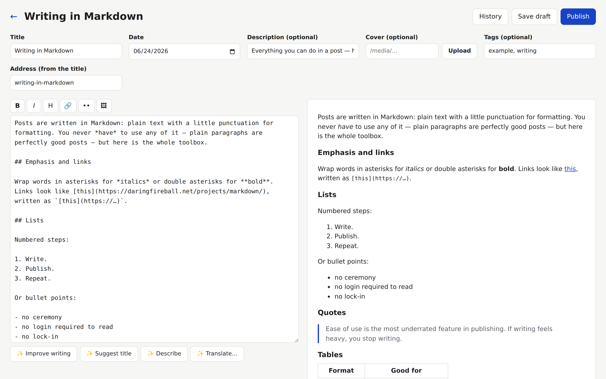
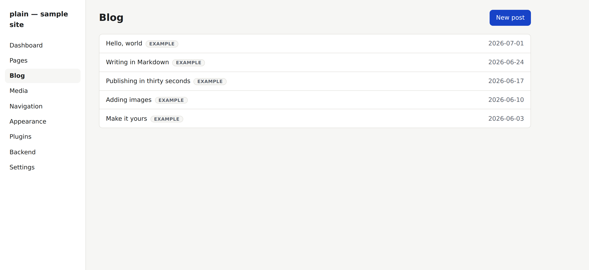

<picture>
  <source media="(prefers-color-scheme: dark)" srcset=".github/logo-dark.svg">
  
</picture>

[](https://github.com/plain-cms/plain/actions/workflows/build-deploy.yml)
[](LICENSE)
[](https://github.com/plain-cms/plain/releases)
[](package.json)

**A CMS that lives in your Git repo.** Markdown files in, static site out, edited in the browser — no database, no server, nothing to patch.

**[Website](https://plain-cms.com)** · **[Try the editor](https://plain-cms.github.io/plain/admin/?demo=1)** · **[Live demo](https://plain-cms.github.io/plain/)** · **[Quickstart](#quickstart-5-minutes)** · **[Contributing](CONTRIBUTING.md)**

## Moving an existing site in

> **NEW: WordPress migration.** Bring your whole WordPress site over with one command — posts, pages, images, menu, comments, and every old URL redirected.

**From WordPress, in three steps:**

1. In your WordPress dashboard: **Tools → Export → All content → Download Export File.** You get one `.xml` file.
2. In your plain repo, run:

   ```sh
   node tools/migrate/wordpress.js ~/Downloads/yoursite.WordPress.xml
   ```

3. Copy the result in and build:

   ```sh
   cp -R plain-import/content/. content/
   cp -R plain-import/media/. media/
   cp plain-import/data/redirects.json data/redirects.json
   node build.js
   ```

What comes across: posts (to `/blog/<slug>/`) and pages (to `/<slug>/`, your static front page becomes the home page), Gutenberg and classic-editor content as clean Markdown (captions, galleries, code, footnotes, reusable blocks), categories and tags, featured images and SEO descriptions, every image your posts use (downloaded into `media/YYYY/MM/` — or copied from a backup with `--uploads=…/wp-content/uploads`), your main menu, an archive of approved comments (no e-mail addresses), and a redirect for every old address — posts, pages, categories, tags, date archives and `/feed/` — so search rankings and shared links survive. Drafts, private and scheduled posts arrive as drafts. Anything the importer can't convert with confidence lands in `plain-import/MIGRATION-REPORT.md` as a short to-do list — nothing is dropped silently.

**What plain doesn't do — by design.** plain has **no database and no server**: your site is static files, which is why it's fast, free to host, and has nothing to patch. So WordPress features that run code on every visit don't come along as-is: plugins like WooCommerce, memberships and logins, live comment forms, and page-builder layouts (Elementor, Divi — the text imports, the layout doesn't). Revisions, widgets and theme settings aren't imported either.

**Need a backend anyway?** Connect one in the admin: **Backend** in the sidebar → paste your API's URL (or click **Create backend repo** to start from the template). It's saved as `services.backend` in `site.config.json`, and plugins such as `contact-form`, `api-form`, `feedback` and `sales-analytics` send their data there — forms, comments and analytics without putting a server inside your site.

**Coming from somewhere else?** Jekyll, VuePress and Joomla importers ship too:

```sh
node tools/migrate/jekyll.js /path/to/your-jekyll-site
node tools/migrate/vuepress.js /path/to/your-vuepress-site
node tools/migrate/joomla.js https://your-joomla-site.example   # crawls the live site
```

Every importer writes into `./plain-import/` (never your working tree), keeps your URLs alive with a complete old→new redirect map, and produces the same migration report. VitePress, Hugo and Eleventy are on the roadmap (§15). The full step-by-step guide — options, keeping your URLs, the cutover checklist — is [`tools/migrate/README.md`](tools/migrate/README.md).



Every site built with plain ships this editor at `/admin/`: Markdown with live preview, drafts and publishing, image uploads, and per-page History with one-click restore. It is static files inside your own build — there is no second service to deploy, and nothing extra to pay for.

Your whole website is a folder of plain files: Markdown for content, JSON for settings. Git gives you versioning, collaboration, and hosting hooks for free. The build turns it into a fast static site — HTML pages plus a read-only JSON API — that deploys anywhere for $0/month.

- **No database, no server, nothing to patch.** All state lives in this repo.
- **Vanilla by design.** No frameworks, no bundlers. One dependency: [`marked`](https://github.com/markedjs/marked). The entire engine is a few small, readable files.
- **Works without JavaScript.** JS is progressive enhancement only.
- **AI-operable.** Deterministic layout, a machine-readable content model, and [Claude Code skills in the box](#writing-from-your-terminal) so “write a post about X” is a one-line job that ends in a verified build.



## Signing in to the admin

Once your content is in (imported or brand new), you manage it at **`https://<your-site>/admin/`**. plain has no accounts and no passwords: every Save is a commit to your GitHub repository, so "signing in" just means giving the admin permission to write to that one repository. Pick one of two ways.

### Option A — paste a GitHub token (two minutes, nothing to deploy)

1. On GitHub, open **Settings → Developer settings → Personal access tokens → Fine-grained tokens** and click **Generate new token**. (Direct link: [github.com/settings/personal-access-tokens/new](https://github.com/settings/personal-access-tokens/new).)
2. **Token name:** anything, e.g. `my-site admin`. **Expiration:** your choice. When it runs out, you generate a new one and paste it again.
3. **Repository access:** choose **Only select repositories** and pick your site's repository. Nothing else.
4. **Permissions → Repository permissions:**
   - **Contents: Read and write**: lets the admin save, publish and upload images.
   - **Actions: Read-only**: lets the admin show whether your site finished building.
5. Click **Generate token** and copy it (it starts with `github_pat_`). GitHub shows it only once.
6. Open your site's `/admin/`, check the repository box (`owner/repository`), paste the token, and click **Sign in**.

That's it, and you're publishing. The token is stored only in that browser and is sent only to `api.github.com`; it never touches your site or any server. Each writer signs in once per device with their own token. Editors who prefer files can keep editing files: the admin and direct edits work side by side.

### Option B — a "Sign in with GitHub" button (one click for every writer)

If pasting tokens is awkward (a team, or a client), deploy the optional ~60-line [OAuth Worker](workers/oauth/README.md). It runs free on Cloudflare, backed by a free GitHub App, and you own both parts. Then add `"oauthUrl": "https://<your-worker>.workers.dev"` to the `site` block of `site.config.json` and rebuild. The sign-in screen gains a **Sign in with GitHub** button, and the token form moves under "or use an access token". Each writer clicks once, approves on GitHub, and gets a token scoped to just that repository's contents.

A plain-language walkthrough of both options, including the GitHub App screens and the one-Worker-per-site gotcha: **[Signing in to Plain: a pasted token, or one click with GitHub](https://victorantos.com/posts/two-ways-to-sign-in-to-your-plain-admin/)**.

**AI assist (optional, BYOK):** paste an Anthropic API key in Settings and the editor grows ✨ buttons — improve writing, suggest titles, generate the meta description, write image alt text, translate a page into a new draft. Every suggestion shows a before/after and asks before applying. The key stays in your browser and is sent only to Anthropic.

## Try it locally (about 20 seconds)

```bash
git clone https://github.com/plain-cms/plain.git && cd plain
npm install && npm run dev     # → http://localhost:4000, admin at /admin/
```

## Quickstart (5 minutes)

1. **Get a copy:** click **Use this template** (or fork) to create your own repo.
2. **Enable hosting:** in your repo, go to **Settings → Pages** and set **Source** to **GitHub Actions**.
3. **Make it yours:** edit `site.config.json` — set your `title`, `description`, and `url` — and commit.
4. Push (or edit on github.com and commit). About 30 seconds later, your site is live.

Every later change is the same loop: edit → commit → live in ~30s. Nothing is ever lost; any version of any page can be restored from Git history.

## Try the admin without installing anything

**[Open the editor →](https://plain-cms.github.io/plain/admin/?demo=1)** — no account, no sign-up. You get a copy of the demo site in your browser: write a post, publish it, watch the build, open History and restore an older version. Everything works; nothing leaves your tab, and closing it throws it away.

It is not a mock-up. The demo is the real admin talking to a repository that lives in the browser, seeded from the site's own published JSON API. Add `"demo": true` to the `site` block of your `site.config.json` to offer the same thing on your site.

## The API — your content as JSON

Every build also publishes a read-only JSON API: `/api/site.json`, `/api/posts/index.json`, `/api/posts/<slug>.json` — plain static files any script, app, or AI agent can consume. No keys, no rate limits, cached by the CDN.

## Writing content

A post is a Markdown file in `content/posts/`. The filename is the URL: `hello-world.md` → `/blog/hello-world/`.

```markdown
---
title: Hello world
date: 2026-07-05
description: One sentence for search engines and link previews.
tags:
  - launch
draft: false
---

Body in **Markdown**. Images by path: 
```

Set `draft: true` and the post is saved but not published. Pages work the same in `content/pages/` (`about.md` → `/about/`; `index.md` is the homepage). Menus live in `data/navigation.json`; renamed URLs get an entry in `data/redirects.json`.

## Writing from your terminal

Your site is a folder of files, so an AI coding agent can run it. Open the repo
in [Claude Code](https://claude.com/claude-code) and say what you want:

> *"Write a post about the three things I learned launching this site, then publish it."*

Every site made from this template ships three skills in `.claude/skills/`, which
Claude Code picks up automatically:

| Skill | What it knows how to do |
| ----- | ----------------------- |
| **plain-post** | write, edit, publish, unpublish, or translate a post or page |
| **plain-site** | images, the menu, the footer, settings, redirects, themes, plugins, languages, deploys |
| **plain-extend** | add a field or a whole content type, a landing page, a plugin, a starter |

They are recipes, not magic. `plain-post` tells the agent to read your
collection's fields out of `site.config.json` before writing a line, so the
frontmatter is right the first time; to keep filenames as slugs, because the
filename *is* the URL; to add a redirect whenever a URL changes; and to run the
tests and a build before anything is committed. If the content is wrong, the
build stops with the file, the line, the problem, and the fix — so a bad post
never reaches your readers.

What you'll see: the agent writes the Markdown file, runs `node --test tests/`
and `node build.js`, and shows you the result. **Publishing is still your call** —
the permission allowlist in `.claude/settings.json` covers building and
inspecting, never `git commit` or `git push`. Say the word and it commits with
the same message style the admin uses (`post: publish "Title"`), pushes, and your
site is live about thirty seconds later.

Using a different agent? The skills are plain Markdown — point any tool at
`.claude/skills/` and it gets the same instructions.

## Themes & starters

First sign in and the admin greets you with a five-step wizard: pick what you're building, name it, see it (a live preview already wearing your name), write your first words, and go live. Under the hood it applies a **starter** — a theme plus the right content types, menu, and example content.

115 starters ship in the box, in 17 families. A family is one kind of site with one content model, so you can switch between its themes without touching your content. Every theme looks finished without a single photo and comes with its interface words in eight languages.

| Family | Themes |
| ------ | ------ |
| Restaurant and café (11) | bistro, chippy, slurp, calzone, crumb, alehouse, kerbside, saucer, tandoor, nightcap, fryup |
| Trades and local services (11) | toolbox, eggshell, clippers, eaves, dualcontrol, carton, grout, topsoil, dovetail, suntrap, gasket |
| Shop window (10) | cleaver, punnet, flyleaf, gatefold, rivet, skein, perennial, kiln, loupe, diecast |
| Clinic and practice (8) | practice, eyechart, apothecary, lumbar, syllable, trimester, dewclaw, decibel |
| Studio and classes (8) | form, lanes, bout, crux, lexicon, etude, tearoff, barre |
| Portfolio (8) | studio, elevation, roughs, ticking, reel, stet, chisel, linocut |
| Personal page and CV (7) | folio, mariner, credits, souschef, jotter, strata, mandate |
| Club and community group (8) | hydrant, vestry, quorum, bookbag, switchback, jamboree, bygones, dugout |
| Event (6) | tombola, vows, lanyard, advent, eulogy, wristband |
| Property, accommodation and rental (7) | keys, tenancy, buzzer, seaview, fieldgate, hideaway, showhome |
| Nonprofit and campaign (7) | cause, undersigned, cairn, bequest, pushrim, hustings, dropin |
| Musician and performer (6) | encore, bandstand, backpatch, squeezebox, mixtape, drawstop |
| Professional services (7) | taxreturn, chambers, apostille, patent, vigil, lintel, retrofit |
| Newsletter and writing (8) | default (Journal), letters, terminal, datestamp, seedtime, doublebill, backissue, footpath |
| News and magazine (1) | gazette |
| Manual and handbook (1) | manual |
| Product and software (1) | launch |

[`themes/CATALOGUE.md`](themes/CATALOGUE.md) has a one-line brief for each theme, and [`themes/CONTACT-SHEET.html`](themes/CONTACT-SHEET.html) shows every home page side by side. The Appearance screen lets you try any of them on *your own pages* — with device widths and a light/dark toggle — before committing, and a customizer exposes each theme's colors and fonts as live controls. Your tweaks survive theme updates.

## Sites running plain

| Site | What it is | What it shows |
| ---- | ---------- | ------------- |
| [plain-cms.com](https://plain-cms.com) | the project's own website | the default theme, published in four languages (en / de / fr / ro) |
| [plain-cms.github.io/plain](https://plain-cms.github.io/plain) | the live demo | this repo's sample content, built and deployed by the workflow in `.github/workflows/` |
| [angjobs.com](https://angjobs.com) | a job board | a custom `jobs` collection and a custom theme, deployed to its own server instead of GitHub Pages |
| [victorantos.com](https://victorantos.com) | personal portfolio + blog | the **Terminal** starter with landing-page sections (features, testimonials, FAQ) |
| [antofica.com](https://antofica.com) | a personal blog in five languages | Romanian, English, Russian, German and French from one repo of sibling `.md` files |
| [niche.careers](https://niche.careers) | a SaaS landing site | data-only collections (`render: false`) composing a single landing page, and `api-form` posting leads to its own backend |

Built something with plain? Open a pull request adding it to this list.

## Plugins

A plugin is a folder — install one by copying it into `plugins/` and adding its name to `"plugins"` in `site.config.json`. Ships with **search** (enabled: a `/search/` page over a prebuilt index, no services involved — link a theme search box straight to `/search/?q=…`) and **contact-form** (disabled reference: write `[[contact-form]]` in any page, point it at a Formspree-style endpoint). The full hook API is documented in [`CLAUDE.md`](CLAUDE.md) — it's small enough that "write me a plugin that adds reading time" is a one-prompt job for an AI agent. Also included: **reading-time** (enabled) — written by an AI agent from the docs alone, in one prompt, as proof of that claim — plus **api-form** (forms declared in config, POSTing to your own backend via the `"services"` map) **goatcounter** (opt-in page-view counts) and **structured-data** (enabled: Schema.org JSON-LD for every page, built from the fields you already write — nothing to fill in, no script in the browser). Good first plugins: giscus comments, image gallery, table of contents.

## Staying up to date

plain follows [semver](https://semver.org). Engine files (`build.js`, `lib/`, `admin/`, `themes/default/`) are upstream-owned; your content, config, and custom themes are yours. When a new version ships, the admin shows an **Update available** banner: click it and a pull request appears with the changelog and any files you'd customized flagged for review. **Merge to upgrade, revert to roll back** — never a surprise. An optional weekly workflow opens that PR on its own, so even an unattended site keeps getting security fixes as reviewable PRs. See §14 for the mechanism.

## The rest of the org

plain is one repo — the engine you clone. Three sibling repos in the [plain-cms](https://github.com/plain-cms) organization extend it, and you only need them when you want what they offer:

| Repo | What it is | When you need it |
| ---- | ---------- | ---------------- |
| [**plain-cms/plugins**](https://github.com/plain-cms/plugins) | Curated registry of optional plugins — comments, table of contents, lightbox, related posts, GitHub stars, CV. Every entry is reviewed, because plugins are code that runs in your build or your visitors' browsers. | The admin's **Plugins** screen reads this registry: Install copies the folder into your `plugins/` and enables it in `site.config.json`, as one commit. |
| [**plain-cms/starters**](https://github.com/plain-cms/starters) | Catalog of community themes and starters beyond the 115 in the box — each entry points at a theme folder in some repo. | **Appearance → Browse more** in the admin: preview a theme on your own pages, then Install to copy it into your site. |
| [**plain-cms/backend**](https://github.com/plain-cms/backend) | Two interchangeable reference backends (.NET 10 and vanilla Node), same API, one SQLite file. Deploy one and point your site's `services.backend` at it. | Only for the handful of opt-in plugins that need somewhere to send data — analytics beacons, contact submissions, feedback. Everything else stays fully static. |

Adding to any of them is a pull request: a plugin folder (see the plugins repo's [CONTRIBUTING.md](https://github.com/plain-cms/plugins/blob/main/CONTRIBUTING.md)), a registry entry that passes the theme quality floor, or a backend route.

## Local development

```sh
npm install
node build.js            # build into dist/
node build.js --watch    # serve on http://localhost:4000, rebuild on change
node --test tests/       # run the test suite
node tools/engine-manifest.js   # regenerate engine.json before a release
```

## Layout

```
site.config.json   all configuration: site info, collections, plugins
config.defaults.json  engine-owned defaults, merged under your config
content/           your words (Markdown, one file per page/post)
data/              navigation, redirects (JSON)
media/             images and files
themes/            115 starters ship in the box; add your own
families/          one content contract per family of themes
plugins/           a plugin is a folder; install = copy + enable in config
admin/             the browser editor (static, vanilla ES modules)
.claude/skills/    recipes for Claude Code: write a post, run the site, extend it
tools/migrate/     importers (WordPress, Jekyll, VuePress, Joomla)
workers/oauth/     optional "Sign in with GitHub" worker (v1 uses a token)
build.js + lib/    the whole engine — under 2,500 lines, one dependency, MIT
```

The full product specification lives in [`cms-spec.md`](cms-spec.md); instructions for AI agents (and how to add collections, plugins, themes) in [`CLAUDE.md`](CLAUDE.md) and [`.claude/skills/`](.claude/skills/). To contribute, read [`CONTRIBUTING.md`](CONTRIBUTING.md).

## License

[MIT](LICENSE) — open source from day one. Themes, plugins, and importers are the adoption engine; the core will never be closed.
